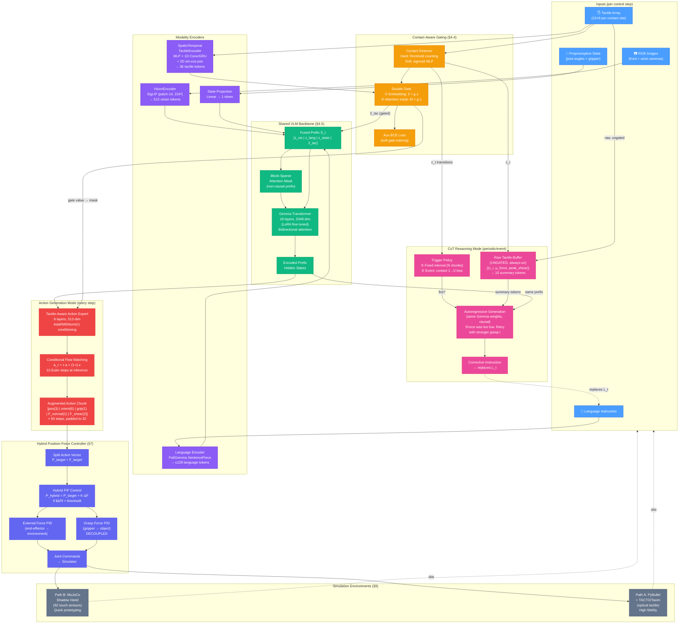
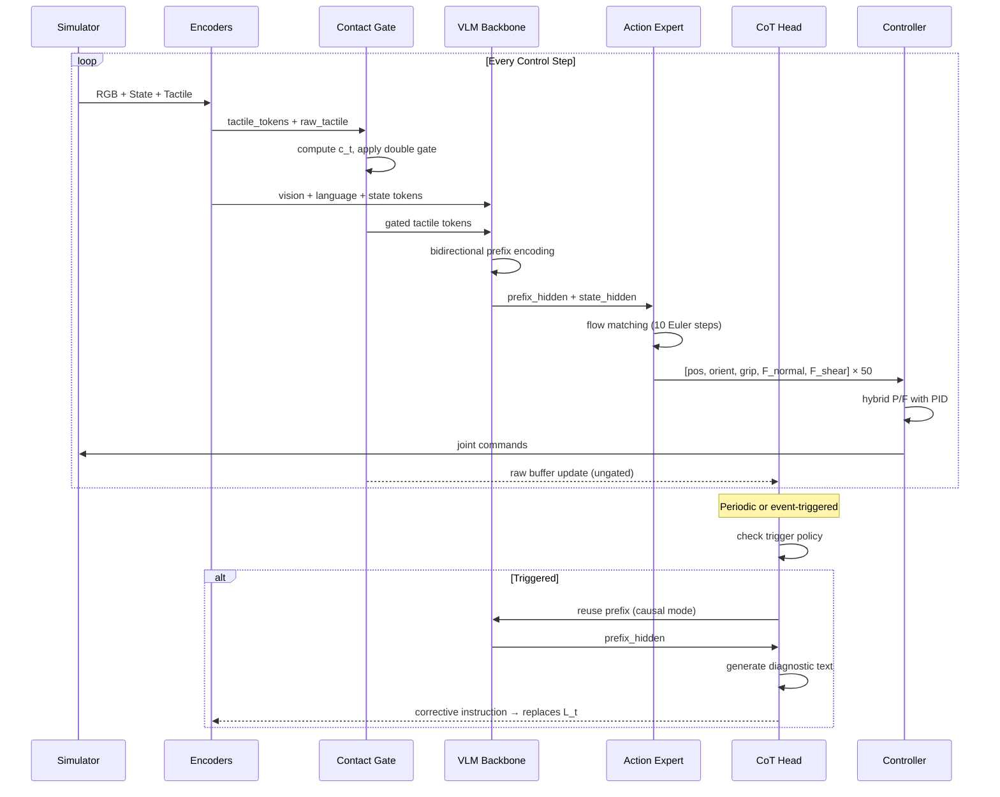
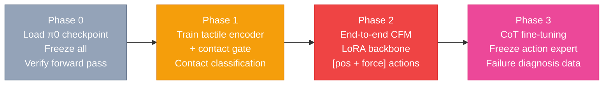

# CATE-π Implementation Walkthrough

## What Was Built

The complete CATE-π (Contact-Aware Tactile-Expert π-VLA) codebase — **31 files** across **7 packages** — implementing the merged architecture from π0, Tactile-VLA, and TacVLA.

---

## Architecture Diagram

---

## Data Flow Summary

---

## File Structure (31 files, ~200KB)

| Package | File | Description | Lines |
|---------|------|-------------|-------|
| `configs/` | [`backbone_pi0_base.yaml`](file:///p:/Pi-VLA/cate_pi/configs/backbone_pi0_base.yaml) | PaliGemma backbone + action expert + action space | ~85 |
| | [`tactile_sensor.yaml`](file:///p:/Pi-VLA/cate_pi/configs/tactile_sensor.yaml) | Sensor layout, encoder, gate, CoT buffer | ~60 |
| | [`training_phase0.yaml`](file:///p:/Pi-VLA/cate_pi/configs/training_phase0.yaml) | Phase 0: backbone init verification | ~20 |
| | [`training_phase1.yaml`](file:///p:/Pi-VLA/cate_pi/configs/training_phase1.yaml) | Phase 1: gate warm-up | ~50 |
| | [`training_phase2.yaml`](file:///p:/Pi-VLA/cate_pi/configs/training_phase2.yaml) | Phase 2: CFM fine-tuning | ~70 |
| | [`training_phase3.yaml`](file:///p:/Pi-VLA/cate_pi/configs/training_phase3.yaml) | Phase 3: CoT fine-tuning | ~70 |
| **`models/`** | [`attention_masks.py`](file:///p:/Pi-VLA/cate_pi/models/attention_masks.py) | Block-sparse mask: prefix (bidir) + suffix (causal) + contact gating | ~250 |
| | [`vision_encoder.py`](file:///p:/Pi-VLA/cate_pi/models/vision_encoder.py) | SigLIP wrapper, multi-camera, per-camera embeddings | ~160 |
| | [`tactile_encoder.py`](file:///p:/Pi-VLA/cate_pi/models/tactile_encoder.py) | Spatio-temporal: MLP + conv/GRU + 2D sin-cos pos, 36 tokens | ~270 |
| | [`contact_gate.py`](file:///p:/Pi-VLA/cate_pi/models/contact_gate.py) | Hard + soft gate with double gating + aux BCE loss | ~200 |
| | [`vlm_backbone.py`](file:///p:/Pi-VLA/cate_pi/models/vlm_backbone.py) | PaliGemma/Gemma backbone, prefix encoding, state projection | ~260 |
| | [`action_expert.py`](file:///p:/Pi-VLA/cate_pi/models/action_expert.py) | Tactile-aware CFM action expert, Euler ODE, per-channel metrics | ~350 |
| | [`cot_head.py`](file:///p:/Pi-VLA/cate_pi/models/cot_head.py) | CoT reasoning: raw buffer + trigger policy + autoregressive gen | ~400 |
| **`controllers/`** | [`hybrid_position_force.py`](file:///p:/Pi-VLA/cate_pi/controllers/hybrid_position_force.py) | Classical P/F controller, decoupled ext/grasp, PID, safety | ~280 |
| **`data/`** | [`dataset.py`](file:///p:/Pi-VLA/cate_pi/data/dataset.py) | Multi-modal dataset with synthetic fallback | ~260 |
| | [`action_normalization.py`](file:///p:/Pi-VLA/cate_pi/data/action_normalization.py) | Per-channel quantile normalization (prevents force channel loss) | ~200 |
| | [`force_adverb_labeler.py`](file:///p:/Pi-VLA/cate_pi/data/force_adverb_labeler.py) | Auto-labels force→adverb for Tactile-VLA Table 2 experiments | ~240 |
| **`sim/`** | [`pybullet_tacto_env.py`](file:///p:/Pi-VLA/cate_pi/sim/pybullet_tacto_env.py) | Path A: high-fidelity optical tactile + domain randomization | ~350 |
| | [`mujoco_shadowhand_env.py`](file:///p:/Pi-VLA/cate_pi/sim/mujoco_shadowhand_env.py) | Path B: 92 touch sensors, turn-key prototyping | ~270 |
| **`training/`** | [`train_phase1_gate_warmup.py`](file:///p:/Pi-VLA/cate_pi/training/train_phase1_gate_warmup.py) | Phase 1: isolated gate training with F1/gate distribution tracking | ~260 |
| | [`train_phase2_cfm_finetune.py`](file:///p:/Pi-VLA/cate_pi/training/train_phase2_cfm_finetune.py) | Phase 2: end-to-end CFM with per-channel loss monitoring | ~300 |
| | [`train_phase3_cot_finetune.py`](file:///p:/Pi-VLA/cate_pi/training/train_phase3_cot_finetune.py) | Phase 3: CoT on failure/diagnosis data with anti-forgetting mix | ~280 |
| **`eval/`** | [`eval_suite.py`](file:///p:/Pi-VLA/cate_pi/eval/eval_suite.py) | Success rate, force accuracy, latency benchmarking | ~280 |
| | [`ablations.py`](file:///p:/Pi-VLA/cate_pi/eval/ablations.py) | 10-variant ablation table (mirrors TacVLA structure) | ~250 |

---

## Key Design Decisions Implemented

| Decision | Rationale |
|----------|-----------|
| **Double gating** (mask + embedding zero) | TacVLA shows both are needed — masking alone leaks positional offsets, zeroing alone lets attention attend to zero tokens |
| **Soft learnable gate** (sigmoid MLP + BCE) | Addresses TacVLA's stated limitation: hard threshold doesn't handle ambiguous near-contact frames |
| **Raw ungated CoT buffer** | Gating blinds the reasoning pathway to contact→non-contact transitions needed for slip detection |
| **Per-channel quantile normalization** | Without it, position (meters) dominates force (Newtons) in CFM loss — force channels get ignored |
| **Decoupled external/grasp force** | Physically distinct quantities (pressing on environment vs. squeezing object) — conflating them is a common bug |
| **Event-triggered CoT** | Catches slips faster than fixed-interval by detecting unexpected contact loss mid-grasp |
| **Separate action/CoT forward paths** | §5 recommendation: easier to test and debug than one function with mode branching through mask logic |

---

## Training Pipeline

